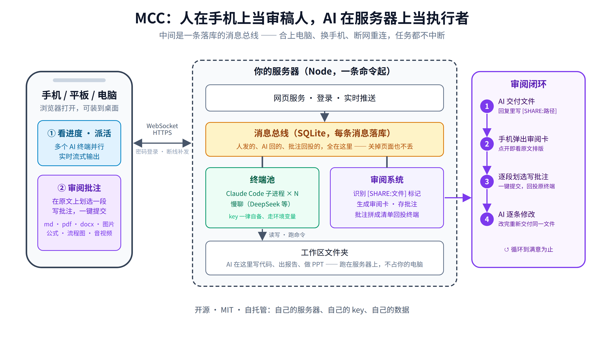

# MCC · Direct the AI on your server from your phone

[中文](README.md) | English

**AI agents work on your own computer or server; you assign tasks, watch progress, and annotate what they deliver — right on your phone.** Installed on a server, it keeps running when your laptop is closed.

[](https://github.com/Sebastilan/mccv2-lite/releases/download/v0.1.0/mcc-demo.mp4)

▶ **[Full demo, 2 min 8 s (Chinese voice-over + Chinese/English captions; 1080p phone-viewport run at real speed, no edits)](https://github.com/Sebastilan/mccv2-lite/releases/download/v0.1.0/mcc-demo.mp4)** · the GIF above is a 4× preview

> Note: the web UI and MCC's built-in instructions to the AI are currently in **Chinese**. You can talk to the AI in any language.

## Highlights

- **Your phone is the workstation**: works in any mobile browser, can be added to the home screen as an app. All AI terminals on one screen, see at a glance who is busy; one tap on the tab bar to switch.
- **The AI runs on the server, not on your laptop**: terminals are server processes — closing the laptop, locking the phone or switching networks doesn't interrupt them; every message is stored and replayed after reconnects.
- **Review AI output like grading homework**: when the AI delivers a file, a review card pops up. Select any passage and comment — md / pdf / docx / xlsx / images / formulas / diagrams / audio & video. Submit once; comments become a checklist sent back to the AI, which fixes each item and redelivers.
- **Zero setup per task**: new terminals don't ask for a folder — they all share one workspace and the AI creates task subfolders itself. When the AI is unsure, its question shows up as buttons you tap.
- **Your AI assistant can install it for you**: hand this repo to your AI assistant; following [`AGENTS.md`](AGENTS.md) it asks you a few questions, installs MCC, runs an end-to-end check and reports back.
- **Three kinds of terminal**: Claude Code (most capable), **Codex** (OpenAI, ChatGPT account login), and the **"dumb loop"** (a tiny agent loop with a single shell tool that works with any Anthropic- or OpenAI-compatible model, e.g. DeepSeek). Review and annotation work the same for all three.
- **Your machine, your keys**: fully open source (MIT); data stays on your machine.



In one line: **you review on the phone, the AI executes on the server, connected by a persistent message bus.**

## Install: hand it to your AI assistant

**Easiest way: send this sentence to your AI assistant** (Claude Code, Codex, or any assistant that can run commands). It follows [`AGENTS.md`](AGENTS.md), asks what it needs, installs, runs the self-test and a full "assign → review → annotate → redeliver" check, and reports:

> Please deploy MCC for me following the AGENTS.md in this repo: https://github.com/Sebastilan/mccv2-lite . Ask me for whatever you need first, and report back in its "报结果" (report) format when done.

The four things it will ask (have them ready):
1. **Which model account**: Claude subscription, Anthropic API key, DeepSeek API key, or a ChatGPT account (for Codex). **Put the key in a file yourself and tell the AI the path — don't paste keys into the chat.**
2. **Where you'll use it**: only on this computer / also phones and tablets on the same Wi-Fi / also when you're out.
3. If you'll use it while out: do you have a cloud server, a domain name? (Neither? A tunnel works.)
4. Set the login password yourself, or let the AI generate one?

Doing it yourself: follow `AGENTS.md` (Chinese) step by step; the three sections below are the gist.

## 1. Use it in a browser on this machine

```bash
git clone https://github.com/Sebastilan/mccv2-lite ~/mcc && cd ~/mcc
npm install && npm run selftest                          # Node.js >= 20; ends with "自检通过" (self-test passed)
npm install -g --prefix ~/.npm-global @anthropic-ai/claude-code   # default terminal (no sudo)
cp .env.example .env && chmod 600 .env                    # model key, see section 3
set -a; . ./.env; set +a; npm start                       # ready when it prints "ready in"
```

Open `http://127.0.0.1:47834` (no password from the machine itself) → "+ 新建终端" (new terminal) → pick a terminal type → assign a task in one sentence, e.g. "Turn outline.md into a 5-slide outline and send it to me for review" → tap the review card → select passages and comment → "提交反馈" (submit) → the AI revises and redelivers.

| Terminal | What it is | Needs |
|---|---|---|
| Claude Code (default) | Anthropic's official CLI, one long-lived process per terminal, most capable | `claude` + a Claude subscription login, or `ANTHROPIC_API_KEY` / `DEEPSEEK_API_KEY` |
| Codex | OpenAI Codex CLI, one `codex exec --json` per message, no memory while idle | `codex` + `codex login` (ChatGPT account or API key) |
| Dumb loop | Minimal agent loop: one `run` tool (shell, parallel commands), auto-compaction at 90%, Anthropic/OpenAI dialects, any model | python3 >= 3.8 + a model endpoint (`LIFE_API`/`LIFE_KEY`/`LIFE_MODEL`, or just `DEEPSEEK_API_KEY`) |
| Slow chat | Lightweight chat with file tools | `DEEPSEEK_API_KEY` or an Anthropic-compatible gateway |

The three working terminals share one workspace and one review convention (a line `[SHARE:/absolute/path]` in the AI's reply opens a review card; comments come back and the AI fixes each and redelivers). Anything missing is reported in the terminal with a hint — never silent.

Checks: offline self-test `npm run selftest`; real end-to-end `npm run e2e -- cc` (or `codex` / `life`) runs create terminal → assign → review card → annotate → redeliver in a throwaway copy and cleans up after itself.

## 2. Connect from phones and tablets

By default MCC listens on 127.0.0.1 only, so phones can't reach it. Pick one (details and checks in `AGENTS.md` section 二):

| Option | When | Domain? | Certificate? | How |
|---|---|---|---|---|
| **Same Wi-Fi** | at home / in the office | no | no (plain HTTP inside your LAN; not on public Wi-Fi) | `.env`: `MCC_HOST=lan` and `MCC_PASSWORD`; open `http://<computer's LAN IP>:47834` on the phone |
| **Cloud server + domain + automatic HTTPS** (recommended) | when you're out; works with your laptop off | yes (a subdomain A record pointing at the server; mainland-China servers need ICP filing for 80/443) | yes — Caddy obtains and renews it automatically | MCC listens on 127.0.0.1 only, two lines of Caddy config as reverse proxy; firewall opens only 80/443 |
| **Tunnel** | when you're out but only have the home computer | no (use the address the tunnel gives you) | handled by the tunnel | e.g. `cloudflared tunnel --url http://127.0.0.1:47834`; afterwards `/api/provider` through the tunnel **must return 401** when not logged in |

There is deliberately no "public IP + plain HTTP port" option: the AI can run any command on the machine, so the password must not cross the internet in clear text. `AGENTS.md` also covers existing Nginx, busy ports and no-root setups (Nginx snippet, user-level systemd).

## 3. What you need

**Machine**: Linux (tested on Ubuntu/Debian family). The server plus its 4 terminal pools uses about 370 MB idle; each open Claude Code terminal adds about 0.4 GB. Dumb loop / Codex only: 1 GB is enough; 1–2 Claude Code terminals: 2 GB or more. 1 vCPU works, 2 is smoother. Disk: repo + dependencies ~40 MB, Claude Code ~0.7 GB, Codex ~0.4 GB.

**Model accounts** (any one; several can coexist): Claude subscription or Anthropic API key (for Claude Code; direct access from mainland China is region-blocked — use an overseas server or a proxy) · DeepSeek API key (works for Claude Code, dumb loop and slow chat) · ChatGPT account (for Codex) · any compatible endpoint (dumb loop). Where to get each, which variable, and what happens when it's missing: the 缺资源清单 (missing-resources) table in `AGENTS.md` section 三.

### Memory of the three terminals

Same small task ("write a three-paragraph note, save it and send it to me for review" → one comment → revise and redeliver), five runs per terminal, medians. Measured as the RSS sum of the terminal's **pool process plus all descendants** (adapter, `claude` / `codex` / `python3`, …; shared libraries counted, so slightly high). **Baseline** = pool process before any terminal exists; **idle** = 4 s after the task; **peak** = max of 200 ms samples. Server core and front end not included.

| Terminal | Pool baseline | Idle (after task) | Peak | First review card / re-delivery after annotation (median) |
|---|---|---|---|---|
| Claude Code | 75 MB | 435 MB | 453 MB | 22 s / 10 s |
| Codex | 70 MB | 125 MB | 340 MB | 16 s / 18 s |
| Dumb loop (DeepSeek) | 70 MB | 125 MB | 185 MB | 7 s / 4 s |

Models: Claude Code on Sonnet 5, Codex on its default (ChatGPT login), dumb loop on DeepSeek V4 Flash; all 5 runs succeeded. Claude Code keeps its `claude` process (plus two built-in MCP processes) resident, hence 435 MB idle; Codex and the dumb loop start a `codex` / `python3` process per message and exit, leaving only the adapter (125 MB, ~70 MB of which is the pool's own Node runtime and SQLite). Spread across runs was small (idle 433–443 / 124–125 / 124–125 MB, peak 445–455 / 335–347 / 184–185 MB). Reproduce: `npm run e2e -- <cc|codex|life>`.

Claude Code terminals are long-lived processes (they stay up between messages); after 60 idle minutes (`CC_IDLE_CHILD_TTL_MS`) the process is reaped to save memory, and the next message resumes the same conversation with `--resume`. Measured time to first token (Opus 5.5): 1.8–2.5 s while resident, 5.2–6.3 s after a reap (resume), 7.9 s for a new session.

### Cost per round

One round of the same small task (write → one comment → redeliver), measured 2026-11-19 from the token usage `npm run e2e` reports:

| Terminal · model | Cost per round |
|---|---|
| Dumb loop · DeepSeek V4 Flash | ≈ CNY 0.013 (DeepSeek peak-hour price; half off-peak) |
| Claude Code · DeepSeek V4 Pro | ≈ CNY 0.35 (same) |
| Claude Code · Claude Sonnet | ≈ USD 0.13 at API prices; no extra charge on a Claude subscription (Pro from USD 20/month) |
| Codex · ChatGPT account | included in a ChatGPT subscription (Plus from USD 20/month) |

Real tasks are typically 10–100× larger; scale accordingly. Token counts per row are in `AGENTS.md` (费用量级).

## Layout

| Path | What it does |
|---|---|
| `server/main.mjs` | Startup: message bus → broadcaster → terminal pools → HTTP/WS |
| `server/http/` | Web server: routing, login, compression, front-end bundle |
| `server/api/` | All HTTP endpoints |
| `server/bus/` | Message bus (SQLite, `data/bus.db`), business DB, WebSocket broadcast, pool notifications |
| `server/terminals/` | One folder per terminal kind: `cc` (Claude Code), `codex`, `life` (dumb loop), `chat` (slow chat), `human` (web client), plus the shared `_base` |
| `server/review/` | Review and sharing: `[SHARE:]` registration, comments sent back, terminal share links |
| `server/policy/` | Worker policies: completion reports, cascade cleanup |
| `server/providers/` | Model provider registry |
| `server/scanners/` | History/session scanners |
| `server/sdk/` | Terminal SDK: the Actor class that joins the bus |
| `server/ops/` | Runtime support: environment config, metrics, service health |
| `web/` | Phone web app (PWA); `review.html` is the review page |
| `protocol/` | Database schemas |
| `test/` | `selftest.mjs` offline self-test, `e2e-terminal.mjs` real end-to-end |
| `scripts/` | Front-end bundling, formula-font copy |
| `bin/` | CLI: post one message to the bus |
| `docs/` | Architecture diagram, video storyboard, 2026-11-19 layout migration map (`layout-map.md`) |

## Security notes

- Terminals run Claude Code with `--dangerously-skip-permissions`: **the AI can run any command on the machine.** Use a dedicated user / machine / container.
- Listens on 127.0.0.1 by default; `MCC_HOST=lan` binds only LAN interfaces. Local connections need no password; everything else must log in, and requests through a reverse proxy or tunnel (carrying `X-Forwarded-For` etc.) always must.
- Review links grant password-free access via a token (valid 24 h by default); share them only with people who should see the file.

## Demo shots ↔ code

The demo video was produced from this repo as-is (automated real taps in a phone viewport, real speed, no edits, Chinese/English captions); storyboard and recording method: [`docs/demo-storyboard.md`](docs/demo-storyboard.md).

| Shot | Shows | Code |
|---|---|---|
| S2 Login | Open in browser, password login, add to home screen | `web/manifest.json` (PWA), `MCC_PASSWORD` |
| S3 Overview | Terminal cards in tiers (lead · aides · helpers) | `web/ui/dashboard.js`, `web/plugins/zone-grouping.js` |
| S4 Switch | One-tap tab bar inside a terminal | `web/ui/terminal.js` |
| S5 Files | Workspace file tree, preview, "annotate this file" | `web/plugins/project-map.js` |
| S6 Assign | One-sentence task; the AI reads/writes files on the server, live on the phone | `server/terminals/cc/`, `server/bus/bus.mjs` |
| S7 Annotate | Review card → select and comment on the original → submit | `server/review/share.mjs`, `web/review.html`, `server/api/review.mjs` |
| S8 Redeliver | Comments become a checklist for the AI, which fixes each and redelivers | `server/review/share-feedback.mjs`, `server/terminals/_base/review-rule.mjs` (review convention in the system prompt) |

## Origin and status

A minimal open-source cut of the author's own MCC v2: internal machine links, WeChat and other private features removed; all keys come from environment variables. Verification status (including a from-scratch install in a clean environment) is in `AGENTS.md`.

## License

MIT (see `LICENSE`). Bundled front-end libraries (KaTeX, mermaid, marked, highlight.js, PDF.js, SheetJS, mammoth, docx-preview, JSZip) are unmodified upstream files under MIT / BSD / Apache-2.0; versions and sources in [`THIRD_PARTY_NOTICES.md`](THIRD_PARTY_NOTICES.md), full texts in `web/lib/LICENSE.txt` and `web/vendor/LICENSE.txt`.
