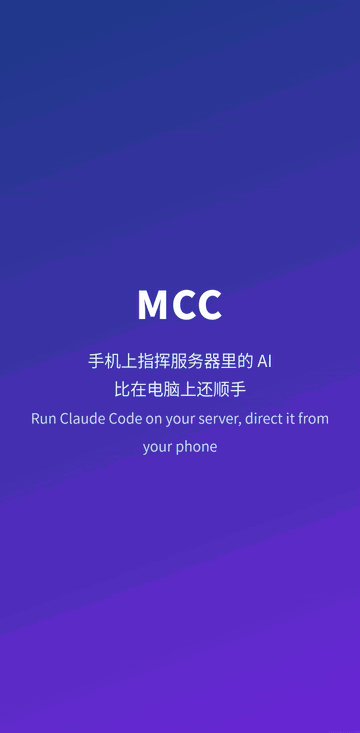
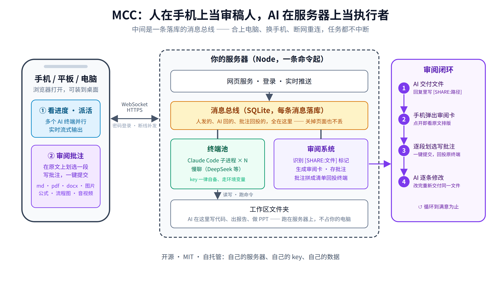

# MCC · 手机上指挥服务器里的 AI

中文 | [English](README.en.md)

**AI 在你自己的服务器上干活,你在手机上派活、看进度、在原文上批注它交来的东西。** 合上电脑也不停。

▶ **[完整介绍视频 1 分 54 秒(中英字幕,手机实录、真实速度、没剪辑)](https://github.com/Sebastilan/mccv2-lite/releases/download/v0.1.0/mcc-demo.mp4)** · 上面是 4 倍速预览

## 亮点

- **手机就是工作台**:浏览器打开就用,可「添加到主屏幕」当 App。多个 AI 终端一屏总览,谁在忙一眼看清;顶部 Tab 一点切换。
- **AI 在服务器上干,不靠你的电脑**:终端是服务器上的进程,合上电脑、锁屏、换网络都不中断;消息全部落库,断线重连自动补发。
- **像改作业一样审 AI 的交付**:AI 交文件时手机上弹出审阅卡,md / pdf / docx / xlsx / 图片 / 公式 / 流程图 / 音视频都能在原文上划选批注;一键提交,批注自动变成清单投回 AI,它逐条改完再交。
- **傻瓜式**:新建终端不用选路径,所有终端在同一个工作区干活,AI 按任务自己建子目录;一句话派活,AI 拿不准时把问题变成按钮让你点。
- **交给你的 AI 就能装好**:把仓库地址丢给你的 AI 助手,它照 [`AGENTS.md`](AGENTS.md) 先问你几个问题,再自动装到云服务器或本机、自检、报结果。
- **自己的服务器、自己的 key**:代码全开源(MIT),数据只在你的机器上;模型可用 Claude 订阅、Anthropic API key 或 DeepSeek key。

一句话:**人在手机上当审稿人,AI 在服务器上当执行者,中间是一条落库的消息总线。**

## 怎么装:交给你的 AI 助手

**最省事的装法:把下面这句话连同本仓地址发给你的 AI 助手**(Claude Code、Codex、WorkBuddy 等能执行命令的助手),它会照 [`AGENTS.md`](AGENTS.md) 先问你几个问题,然后自动装好、自检、把结果报给你:

> 请照这个仓库的 AGENTS.md 帮我部署 MCC:https://github.com/Sebastilan/mccv2-lite 。先问我需要的信息,装完按里面的「报结果」格式告诉我。

AI 会问你的,提前准备好就更快:
1. **有没有云服务器**(阿里云、腾讯云等)或公网 IP?有就装在服务器上(推荐,手机随时连);没有就装在自己电脑上。
2. **用哪种模型账号**:Claude 订阅、Anthropic API key,或 DeepSeek API key(国内好申请:platform.deepseek.com 注册、充值、创建 key)。服务器在中国大陆时直连 Claude 会被拒,用 DeepSeek 最省事。
3. 装在服务器上的话,**有没有域名**(用来上 HTTPS)。
4. 登录密码自己定,还是让 AI 生成。

想自己动手:同样照 `AGENTS.md` 的「路径一 远程部署」或「路径二 本地部署」一步步做。

## 用起来

1. 手机浏览器打开地址、输入密码登录;可「添加到主屏幕」当 App 用。
2. 首页「+ 新建终端」,一句话派活,例如:「把 大纲.md 改写成 5 页幻灯片提纲,写完交我审阅。」
3. 卡片「点击进入审阅」→ 划选段落写批注 →「提交反馈」→ AI 按批注改完重新交付。

离线自检(不联网、不调模型):`npm run selftest`

## 结构

| 位置 | 管什么 |
|---|---|
| `src/main.mjs` | 启动:消息总线 → 广播 → 终端池 → HTTP/WS |
| `src/bus.mjs` | 消息总线(SQLite,`data/bus.db`) |
| `src/pools/cc/` | Claude Code 终端池(stream-json 子进程) |
| `src/pools/chat/` + `adapters/chat/` | 慢聊:轻量对话 agent(DeepSeek 或任意 Anthropic 兼容网关) |
| `src/share.mjs` `src/api/review.mjs` `src/api/share-feedback.mjs` | 审阅系统:[SHARE] 标记 → 审阅卡 → 批注 → 回投 |
| `src/public/` | 前端(PWA);`review.html` 是审阅页 |
| `src/config.mjs` | 部署配置(全部读环境变量) |
| `protocol/*.sql` | 数据库表结构 |

## 安全须知

- 终端以 `--dangerously-skip-permissions` 运行 Claude Code:**AI 能在服务器上执行任意命令**。请用专门的用户 / 机器 / 容器跑 MCC。
- 本机(127.0.0.1)直连免密码;经反向代理进来的请求(带 `X-Forwarded-For` 等转发头,Caddy 默认带)一律要登录。远程部署请设 `MCC_HOST=127.0.0.1` 并只放行 HTTPS 端口,见 `AGENTS.md` 路径一。
- 审阅链接凭 token 免登录访问(默认 24 小时有效),只发给需要看的人。

## 介绍视频镜头对应

介绍视频是用本仓原样跑出来的(手机视口自动真点录制、真实速度、没剪辑,中英字幕);讲座上放的是同一流程的早一版。镜头表与录制方法见 [`docs/demo-storyboard.md`](docs/demo-storyboard.md),想自己重录照它走。

| 镜头 | 演示的是 | 对应代码 |
|---|---|---|
| S2 登录 | 浏览器打开、密码登录、可添加到主屏幕 | `src/public/manifest.json`(PWA)、`MCC_PASSWORD` |
| S3 总览 | 多个终端卡片,按「君 · 臣 · 使」分层 | `src/public/ui/dashboard.js`、`src/public/plugins/zone-grouping.js` |
| S4 切换 | 终端内顶部 Tab 一点即切 | `src/public/ui/terminal.js` |
| S5 找文件 | 工作区文件树,点开预览,「批注此文件」 | `src/public/plugins/project-map.js` |
| S6 派活 | 一句话派活,AI 在服务器上读写文件,手机实时看 | `src/pools/cc/`、`src/bus.mjs` |
| S7 批注 | 审阅卡 → 原文上划选写批注 → 提交 | `src/share.mjs`、`src/public/review.html`、`src/api/review.mjs` |
| S8 重交 | 批注变成清单投回终端,AI 逐条改完重新交付 | `src/api/share-feedback.mjs`、`src/pools/cc/process.mjs`(审阅约定写进系统提示) |

## 来历与状态

从作者自用的 MCC v2 抽出的最小开源版:去掉了内部机器联动、微信等私有功能,key 一律走环境变量。验证状态见 `AGENTS.md`(含干净机从零安装记录)。

## 许可证

本仓代码 MIT(见 `LICENSE`)。前端随附的第三方库(KaTeX、mermaid、marked、highlight.js、PDF.js、SheetJS、mammoth、docx-preview、JSZip)均为上游原版文件,各自许可证为 MIT / BSD / Apache-2.0,清单与版本见 [`THIRD_PARTY_NOTICES.md`](THIRD_PARTY_NOTICES.md),全文在 `src/public/lib/LICENSE.txt`、`src/public/vendor/LICENSE.txt`。
